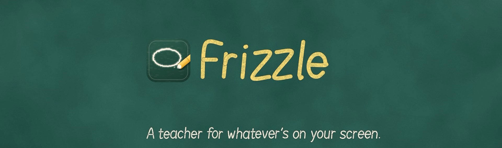
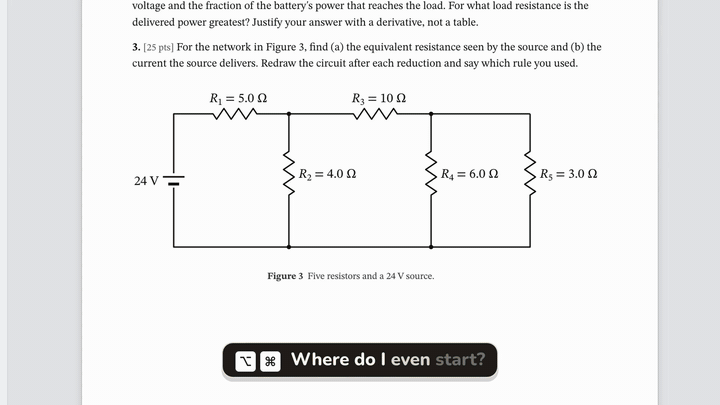

  

<h3 align="center">Hold two keys, ask out loud, and watch the chalk explain it.</h3>

  Frizzle is a Mac app that looks at the window you're asking about, draws the answer right on it in chalk, 
  and talks you through it like a teacher at the board.

  

  <a href="https://frizzleapp.github.io/"><b>Watch the film and see how it works</b></a>

## What it does

| | |
|---|---|
| **Explains what you're looking at** | A lecture slide, a homework PDF, a stack trace, a chart, a circuit. If it's on your screen, you can ask about it. |
| **Draws on your page** | Circles, arrows, struck-out slips and worked steps go straight onto the thing you asked about, not into a chat window. |
| **Talks you through it** | Every lesson is read aloud in a natural voice, with the chalk keeping time. |
| **Looks only when you ask** | Nothing is seen until you hold the keys. Then Frizzle takes one picture of the window you're asking about, and its server doesn't keep it. |

## Where things stand

Frizzle is for macOS 27 on Apple silicon. It's free to start, with Frizzle Pro for more lessons a day.
The download opens soon at [frizzleapp.github.io](https://frizzleapp.github.io/).
